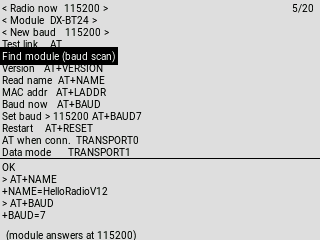

# EdgeTX BT AT Terminal

A Lua tool for **EdgeTX / OpenTX** radios that lets you send **AT commands** to a
**Bluetooth serial module** straight from the transmitter — no laptop, no
USB-serial adapter, no soldering.

Change the module's **baud rate**, **rename** it, **reset** it, or **find** it when
you have forgotten what speed it is set to.



Works with **DX-BT24 / BT24-S / BT27**, **HM-10 / AT-09 / BLE clones**,
**HC-05** and **HC-06** modules.

## Why

Bluetooth serial modules are the usual way to get telemetry from an EdgeTX radio
to a phone app. The catch is that the module and the radio port have to agree on
a baud rate, and modules ship at 9600 while most telemetry setups want 115200.

Changing that normally means pulling the module out, wiring a USB-serial adapter
and typing AT commands on a computer. This tool does it from the radio.

It also removes the classic trap: **every module family numbers its baud rates
differently**. `AT+BAUD4` is 115200 on an HM-10 but 19200 on a DX-BT24. The tool
shows the exact command it is about to send, so you can see what you are doing.

## Install

1. Copy `btterm.lua` to `SCRIPTS/TOOLS/` on the SD card.
2. On the radio: **SYS → HARDWARE → Serial ports**, set **one AUX port to LUA**.
3. Open **SYS → Tools → BT AT terminal**.

Setting more than one port to LUA does not work: EdgeTX applies the baud rate to
the first LUA port and sends the data out of the last one.

When you are done, set the port back to **Telemetry mirror** (or whatever it was)
for normal use.

## Using it

Rows wrapped in `< ... >` are settings and cycle when you press ENTER, everything
else sends a command. The response from the module is shown in the log at the
bottom.

```
< Radio now  9600 >        how the radio is talking right now
< Module  DX-BT24 >        which AT dialect to use
< New baud   115200 >      what the module should be changed to
Test link    AT
Find module (baud scan)
Set baud > 115200 AT+BAUD7
Restart    AT+RESET
```

**To change a module from 9600 to 115200:**

1. `< Radio now >` → **9600** (the rate the module uses today)
2. **Test link AT** → the module should answer `OK`
3. `< New baud >` → **115200**
4. **Set baud** → sends `AT+BAUD7`, module answers `+BAUD=7 OK`
5. **Restart** → `AT+RESET` (the new rate only applies after a reset)
6. `< Radio now >` → **115200**, then **Test link AT** again to confirm

**Lost the module?** **Find module (baud scan)** walks every rate from 2400 to
230400, sends `AT` at each and reports where it answers. Useful after setting a
rate that did not stick, or on a module of unknown origin.

**Renaming:** pick one of the presets, or use **Edit name** to type a custom one
(`+/-` change the letter, `ENT` moves to the next, long `ENT` sends). A reset is
needed for the new name to appear.

## Baud rate numbering

The number after `AT+BAUD` means something different on each module family. This
is the single most common reason a baud change "does not work".

| Baud | DX-BT24 / BT27 | HM-10 / AT-09 | HC-06 |
| --- | --- | --- | --- |
| 2400 | 1 | - | - |
| 4800 | 2 | - | - |
| **9600** | **3** *(default)* | 0 | 4 |
| 19200 | 4 | 1 | 5 |
| 38400 | 5 | 2 | 6 |
| 57600 | 6 | 3 | 7 |
| **115200** | **7** | **4** | **8** |
| 230400 | 8 *(undocumented)* | 5 | 9 |

HC-05 is different again and uses `AT+UART=115200,0,0`.

The tool prints the command it will send on the **Set baud** row, so the mapping
is visible before you press anything.

## Error codes

DX modules answer with `+ERROR=<code>`. The tool translates these in the log:

| Code | Meaning |
| --- | --- |
| 101 | Parameter length error |
| 102 | Parameter format error |
| 103 | Abnormal parameter data |
| 104 | Command not supported by this firmware |

`104` usually means the command exists in the family's documentation but not in
your module's particular firmware. The **BT24-T**, for example, does not have
`AT+TRANSPORT` or `AT+DISC` even though the BT24 guide lists them.

## Radio compatibility

The layout adapts to the screen, so it works on colour and black and white
radios alike: it has been laid out for 128x64, 212x64, 320x240, 320x480, 480x272
and 480x320 displays. Tested on a **HelloRadioSky V12** (320x240) with a
**DX-BT24-T** module.

Any radio running EdgeTX with a spare serial port will do — AUX1, AUX2 or the
USB VCP, whichever one you set to LUA.

## Notes

- Module settings such as baud and name only take effect **after a reset**.
- The DX-BT24 datasheet lists 115200 as the maximum; 230400 is offered because
  some modules accept it, but if the module stops answering, use the baud scan.
- `AT+DEFAULT` restores factory settings, which returns the module to 9600.

## Related

Found while fixing two EdgeTX bugs that broke Ghost telemetry over a serial
port:

- [Telemetry mirror is unusable with a Ghost module](https://github.com/EdgeTX/edgetx/issues/7609)
  — the mirror ran at a baud rate that could not carry Ghost telemetry
- [Radio locks up when a Lua script sends MSP over Ghost](https://github.com/EdgeTX/edgetx/issues/7607)

## License

MIT
